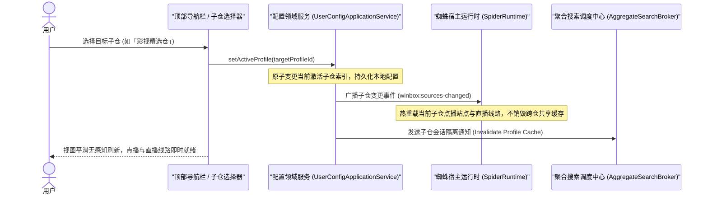
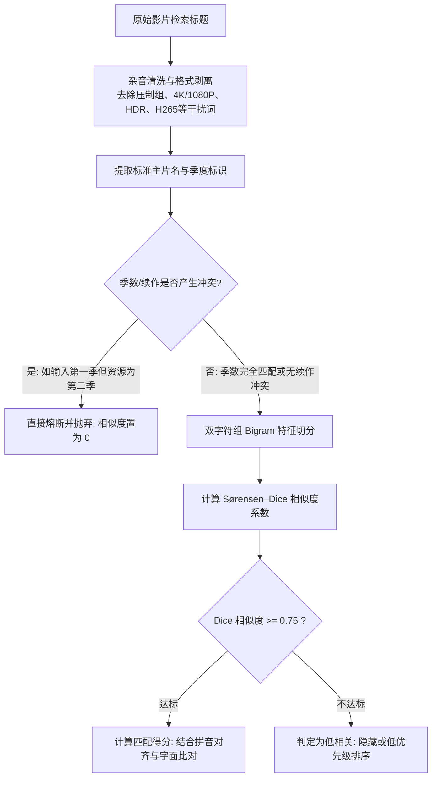
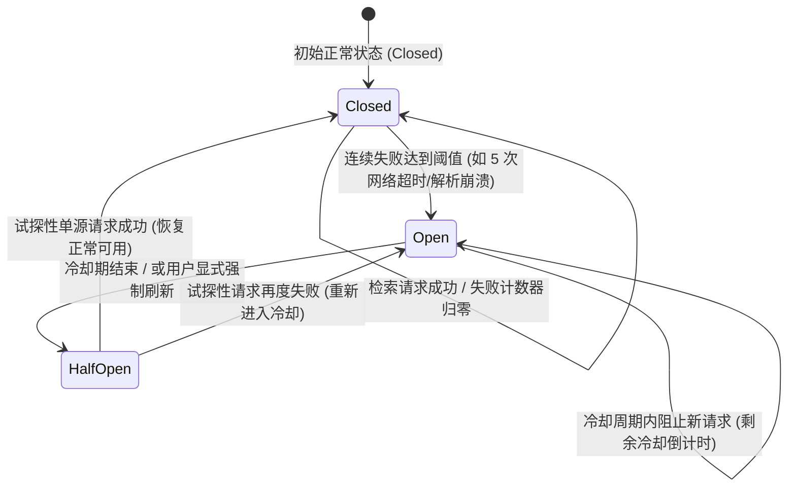
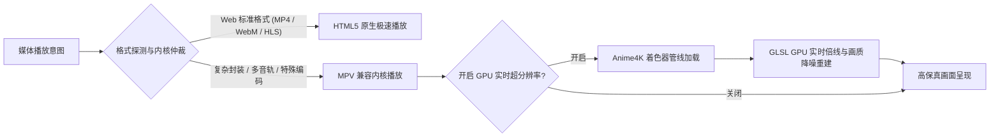
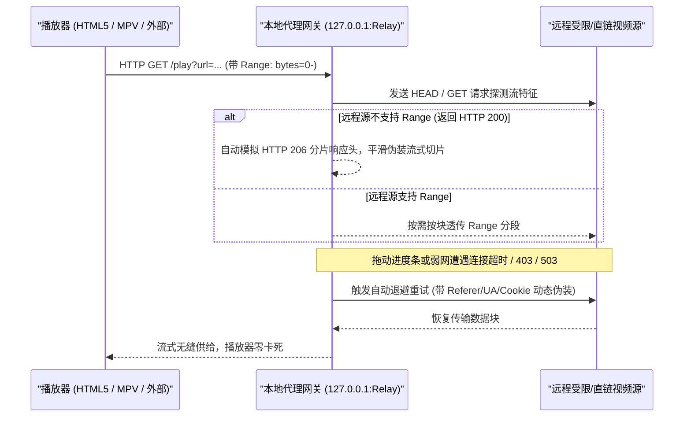

<!--
  Designed & Built with ❤️ by MeiSiristhebest (https://github.com/MeiSiristhebest)
  If this repository helps your learning or engineering, please consider dropping a ⭐ Star!
-->
<h1 align="center">🚀 Win-Box</h1>

<p align="center">
  <b>Windows 桌面端高可用媒体源管理与聚合播放工作站</b>
</p>

<p align="center">
  <a href="https://github.com/MeiSiristhebest/Win-box/releases/latest"></a>
  <a href="https://github.com/MeiSiristhebest/Win-box/actions"></a>
  <a href="LICENSE"></a>
  
  
  
  
</p>

<p align="center">
  <em>基于 Electron + React 19 + TypeScript + Vite 打造的现代 Windows 桌面播放器与多源管理套件。搭载 Linear 级纯净自解释交互、多子仓秒级热切、双字符组（Dice）模糊聚合搜索、智能剧集清洗归一化、HTML5 / MPV GPU 超分（Anime4K）双内核与局域网 DLNA 投屏。</em>
</p>

---

> [!TIP]
> 💡 **如果本项目的架构设计、工程实现或桌面播放体验对您有所启发，欢迎点亮右上角的 ⭐ Star 支持创作者！**
> ⚖️ **使用前请务必仔细阅读本项目的 [⚠️ 免责声明](#️-免责声明请务必阅读)。本项目为个人研究性质的开源播放器外壳工具，不存储、不提供、不推送任何影视内容与资源。**

---

## 📑 目录

- [💡 项目定位与核心特性](#-项目定位与核心特性)
- [🛠️ 核心架构与工程设计](#️-核心架构与工程设计)
  - [1. Linear 级纯净自解释交互 (Linear & Apple Notes Minimalist UX) 🎨](#1-linear-级纯净自解释交互-linear--apple-notes-minimalist-ux-)
  - [2. 多子仓订阅与跨源生命周期隔离 (Multi-Profile Dynamic Switching & Isolation) 🔄](#2-多子仓订阅与跨源生命周期隔离-multi-profile-dynamic-switching--isolation-)
  - [3. 多维实时动态榜单与流媒体聚合索引 (Multi-Domain Live Boards & Streaming Indexing) 📡](#3-多维实时动态榜单与流媒体聚合索引-multi-domain-live-boards--streaming-indexing-)
  - [4. 双字符组模糊匹配与集数清洗归一化 (Dice Bigram Fuzzy Title & Episode Normalizer) 🧠](#4-双字符组模糊匹配与集数清洗归一化-dice-bigram-fuzzy-title--episode-normalizer-)
  - [5. 站点轻量熔断降级与并发搜索隔离 (Source Circuit Breaker & Concurrency Protection) 🛡️](#5-站点轻量熔断降级与并发搜索隔离-source-circuit-breaker--concurrency-protection-️)
  - [6. 双播放内核协商与 MPV GPU 超分辨率 (Dual-Kernel Pipeline & Anime4K GPU Upscaling) 🎬](#6-双播放内核协商与-mpv-gpu-超分辨率-dual-kernel-pipeline--anime4k-gpu-upscaling-)
  - [7. 本地 HTTP Range 分片代理与断流自愈网关 (Virtual Range & Playback Recovery) ⚡](#7-本地-http-range-分片代理与断流自愈网关-virtual-range--playback-recovery-⚡)
  - [8. 局域网 DLNA 投屏与外部播放器联动 (Local DLNA Casting & External Players) 📺](#8-局域网-dlna-投屏与外部播放器联动-local-dlna-casting--external-players-)
  - [9. 全局网盘凭据本地安全加密与跨仓共用 (DPAPI Hardened Cloud Drive Storage) 🔒](#9-全局网盘凭据本地安全加密与跨仓共用-dpapi-hardened-cloud-drive-storage-)
- [📊 技术栈与架构分层](#-技术栈与架构分层)
- [📂 项目目录结构](#-项目目录结构)
- [📦 测试与验证套件](#-测试与验证套件)
- [🚀 快速开始与本地开发](#-快速开始与本地开发)
- [🚢 正式发布与打包预检](#-正式发布与打包预检)
- [⚠️ 免责声明（请务必阅读）](#️-免责声明请务必阅读)
- [📄 开源协议与版权](#-开源协议与版权)
- [⭐ 支持与 Star](#-支持与-star)

---

## 💡 项目定位与核心特性

Win-Box 旨在解决 Windows 桌面端长期缺乏高可用、现代化多媒体源管理与聚合播放工具的痛点：

*   **零冗余信息噪音**：全面贯彻 Linear / 苹果备忘录设计语言，剔除口号、教程长句与微文案，让空间、字体与操作本身说话。
*   **极致跨仓聚合**：支持同时导入多个订阅源（多仓），毫秒级热切换当前主站，并在搜索时自动化发起全仓高并发聚合检索。
*   **真实全网实时榜单**：直连豆瓣、IMDb、Bangumi 每日放送日历，配合 TMDB 动态上映年份滚动及全球主流流媒体（Netflix、Disney+、Apple TV+、腾讯视频等）播出徽标。
*   **健壮容灾与画质管线**：内置熔断器隔离坏源，采用 Sørensen–Dice 双字符组模糊匹配与季数隔离规避异季串联；搭载 HTML5 与内置 MPV 双内核，并提供 Anime4K GPU 实时倍线超分算法。

---

## 🛠️ 核心架构与工程设计

以下核心功能模块均已在本项目中完成工程化落地，点击每个模块中的源码直链，可直接查阅对应的实现细节：

### 1. Linear 级纯净自解释交互 (Linear & Apple Notes Minimalist UX) 🎨

*   **设计思路**：现代高生产力应用不应要求用户阅读长篇微文案或教学式横幅。通过“大留白、自解释层级、清晰的主操作与微边框芯片交互”，让第一次打开应用的用户即可凭借直觉完成所有操作。
*   **实现细节**：
    - **文字降噪**：全面去除界面中所有的“操作指引”、“缓存提示”、“统计标语”与冗长次要标签。
    - **无障碍保障**：在精简可视文本的同时，完整保留符合 WAI-ARIA 规范的 `aria-label`、`aria-pressed`、`aria-live` 属性，清爽不牺牲可访问性。
    - **操作直达**：当影视详情页未匹配到播放线路时，直接呈现高反差主要按钮 `全网聚合搜索`，取代传统的反问式交互与跳转弹窗。
*   **📂 核心源码直链**：
    - [DiscoverPage.tsx (极简发现页布局)](src/renderer/pages/DiscoverPage.tsx)
    - [boards.css (Linear 微边框胶囊与栅格)](src/renderer/features/discovery/boards.css)
    - [BoardPreviewCard.tsx (纯净榜单预览卡片)](src/renderer/features/discovery/components/BoardPreviewCard.tsx)
    - [MovieSourcesPanel.tsx (纯粹播放来源面板)](src/renderer/features/detail/MovieSourcesPanel.tsx)

---

### 2. 多子仓订阅与跨源生命周期隔离 (Multi-Profile Dynamic Switching & Isolation) 🔄

*   **设计思路**：用户常维护多份订阅源（如自建源、多仓订阅、本地文件源）。切换子仓时要求 UI 状态即时无缝更新，同时底层各子仓的蜘蛛缓存、网络代理与故障状态必须完全物理隔离，防止相互污染。
*   **实现细节**：
    - **原子切换调度**：`UserConfigApplicationService` 维护订阅树状态机，单次切换时仅更新活动索引并原子通知视图层刷新，不触发破坏性重载。
    - **代理智能回退**：导入 GitHub 订阅时，若加速代理发生 404 或超时，自动无缝回退请求该仓库原生 Raw 地址。
    - **容灾兼容**：即使某个子仓导入或网络拉取失败，只要本机仍留存已持久化的历史配置，仍可照常切换并使用其有效节点。
*   **子仓切换时序图**：



*   **📂 核心源码直链**：
    - [UserConfigApplicationService.ts (用户配置应用服务)](src/main/store/UserConfigApplicationService.ts)
    - [UserConfigRepository.ts (配置持久化仓储)](src/main/store/UserConfigRepository.ts)
    - [SubscriptionConfigFetcher.ts (订阅拉取与代理回退)](src/main/subscriptions/SubscriptionConfigFetcher.ts)

---

### 3. 多维实时动态榜单与流媒体聚合索引 (Multi-Domain Live Boards & Streaming Indexing) 📡

*   **设计思路**：传统播放器的“发现”内容往往依赖固定源站或固定死数据。Win-Box 通过去中心化 API 聚合真实的第三方权威元数据，上映年份根据自然时间自动滚动，实现真正的永不过期。
*   **实现细节**：
    - **全网权威聚合**：接入豆瓣实时热门/高分榜、IMDb Top 250、Bangumi 每日放送日历，以及 TMDB 多语言影视索引。
    - **播出平台聚合（Seerr 范式）**：深度解析 TMDB `watch/providers` 接口，在详情页呈现 Netflix、Disney+、Apple TV+、Amazon Prime Video、腾讯视频、爱奇艺等官方上线平台徽标。
    - **自然年份滚动**：上映年代采用动态窗口算法（`new Date().getFullYear()` 向前递推最近 5 年），彻底告别写死年份的旧代码。
*   **📂 核心源码直链**：
    - [domesticDiscover.ts (豆瓣 / Bangumi / IMDb 实时接口解析)](src/main/meta/domesticDiscover.ts)
    - [tmdbProvider.ts (TMDB 元数据与流媒体播出平台解析)](src/main/meta/tmdbProvider.ts)
    - [discoverBoards.ts (榜单注册表与动态自然年份计算)](src/shared/discoverBoards.ts)
    - [DiscoverDetailPageView.tsx (播出平台徽标渲染)](src/renderer/pages/DiscoverDetailPageView.tsx)

---

### 4. 双字符组模糊匹配与集数清洗归一化 (Dice Bigram Fuzzy Title & Episode Normalizer) 🧠

*   **设计思路**：聚合搜索各源返回的标题格式千奇百怪（夹杂压制组、分辨率、编码、标点符号），简单的前缀匹配极易发生误漏。借鉴开源优秀实践引入双字符组模糊算法，同时设置严格的续作/季度隔离门禁。
*   **实现细节**：
    - **Sørensen–Dice 系数**：将标题切分为长度为 2 的字符子串集合（Bigrams），计算重合度比率，无需维护庞大的编辑距离矩阵，计算速度极快且极度适应中文/英数混合词。
    - **续作与异季门禁**：在模糊评分前强制校验季度数字（`S01` vs `S02`、`第1季` vs `第2季`）及尾部罗马/阿拉伯续作编号；若存在冲突直接置为 0 分，杜绝同名不同季的串联错误。
    - **集数清洗提取器**：通过自研的 `episodeNormalizer` 正则管道，清洗压制组、HDR、4K、H265 等噪音，精准提取纯净集数。
*   **标题对齐与清洗流程图**：



*   **📂 核心源码直链**：
    - [searchTitleMatching.ts (Sørensen–Dice 模糊匹配与续作隔离)](src/shared/searchTitleMatching.ts)
    - [episodeNormalizer.ts (集数清洗与杂音过滤管线)](src/shared/episodeNormalizer.ts)

---

### 5. 站点轻量熔断降级与并发搜索隔离 (Source Circuit Breaker & Concurrency Protection) 🛡️

*   **设计思路**：全网聚合搜索会并发向几十上百个第三方源发起请求。部分节点网络超时、域名失效或解析脚本死循环会导致队列阻塞，必须引入微服务级的熔断器（Circuit Breaker）机制。
*   **实现细节**：
    - **三态状态机**：维护 `Closed` (正常)、`Open` (熔断开路)、`Half-Open` (半开试探) 三种状态。
    - **自动隔离与冷却**：当某个源在单次会话中连续出现 5 次网络错误或崩溃，立即触发熔断；进入为期 5 分钟的静默冷却期，期间的聚合搜索直接跳过该源。
    - **刷新豁免与探活**：用户点击“强制刷新”或冷却期结束后，状态流转至 `Half-Open`，放行一次探测请求；若成功则自动重置回健康状态。
*   **熔断器状态流转图**：



*   **📂 核心源码直链**：
    - [sourceCircuitBreaker.ts (源站点熔断状态机)](src/engine/vod/sourceCircuitBreaker.ts)
    - [AggregateSearchCoordinator.ts (聚合搜索并发调度与熔断挂载)](src/main/spider/AggregateSearchCoordinator.ts)

---

### 6. 双播放内核协商与 MPV GPU 超分辨率 (Dual-Kernel Pipeline & Anime4K GPU Upscaling) 🎬

*   **设计思路**：Web 原生播放器资源占用极低但支持格式有限；内置独立 MPV 解码能力极强且支持着色器。Win-Box 设计了全自动内核协商管线，兼顾省电与高画质。
*   **实现细节**：
    - **智能自动降级**：默认优先使用应用内 HTML5 原生播放；一旦探测到格式不受支持或解复用失败，自动无缝无损回退至应用内 MPV 播放器。
    - **Anime4K GPU 着色器超分**：MPV 内核支持加载 Anime4K 等高质量 GLSL 实时倍线超分辨率着色器，提供多种质量档位，显著提升 720P / 1080P 片源在 4K 显示器上的锐度与清晰度。
*   **播放内核协商与超分管线**：



*   **📂 核心源码直链**：
    - [PlayerSuperResolutionControl.tsx (超分辨率着色器挂载控件)](src/renderer/features/playback/PlayerSuperResolutionControl.tsx)
    - [playerPageSessionWorkflow.ts (播放会话状态机与内核降级)](src/renderer/features/playback/application/playerPageSessionWorkflow.ts)
    - [VideoPlayerView.tsx (播放器双渲染视图)](src/renderer/features/playback/VideoPlayerView.tsx)

---

### 7. 本地 HTTP Range 分片代理与断流自愈网关 (Virtual Range & Playback Recovery) ⚡

*   **设计思路**：部分第三方或受限直链视频服务器不支持标准 HTTP Range（分段请求），或对拖动进度条强行返回 HTTP 200，导致播放器无法 Seeking 或直接卡死。
*   **实现细节**：
    - **虚拟 206 流式切片**：本地代理服务（`127.0.0.1` Relay）拦截播放请求，向下游播放器模拟提供标准的 HTTP 206 Partial Content 分片响应头。
    - **断流重试与平滑续传**：当上游连接突发中断时，代理网关自动在后台依据当前 byte 偏移量发起断点重连，播放器无需重新初始化即可连续接收音视频数据流。
*   **Range 分片代理与自愈时序图**：



*   **📂 核心源码直链**：
    - [PlaybackRelayService.ts (流式重传与中继服务)](src/main/server/PlaybackRelayService.ts)
    - [LocalProxyServer.ts (本地代理中继网关)](src/main/server/LocalProxyServer.ts)

---

### 8. 局域网 DLNA 投屏与外部播放器联动 (Local DLNA Casting & External Players) 📺

*   **设计思路**：满足用户将当前媒体流投射到大屏电视，或习惯使用本地专业播放软件（PotPlayer、VLC）的需求。
*   **实现细节**：
    - **UPnP / DLNA 发现与控制**：内置 SSDP 局域网服务发现协议，快速搜索客厅智能电视或机顶盒（DMR）；支持在播放器右键菜单中一键投屏，并可控制暂停、寻道与音量。
    - **外部播放器请求头中转**：支持调用系统中已安装的 PotPlayer、VLC 独立启动；本地代理网关常驻后台，自动注入特定 Referer / User-Agent 伪装头，保障需要校验来源的视频在外部软件中顺利播放。
*   **📂 核心源码直链**：
    - [DlnaService.ts (DLNA 发现与媒体控制协议实现)](src/main/dlna/DlnaService.ts)
    - [DlnaCastControl.tsx (投屏设备选择与会话控制)](src/renderer/features/playback/DlnaCastControl.tsx)
    - [PlayerContextMenu.tsx (播放器交互菜单)](src/renderer/features/playback/PlayerContextMenu.tsx)

---

### 9. 全局网盘凭据本地安全加密与跨仓共用 (DPAPI Hardened Cloud Drive Storage) 🔒

*   **设计思路**：用户在不同子仓中配置的阿里、夸克、UC、百度等网盘源，往往需要挂载个人访问凭据（Cookie / Token）。重复输入既繁琐又存在明文泄露风险。
*   **实现细节**：
    - **Windows DPAPI 硬件级加密**：通过 Electron `safeStorage`（底层基于 Windows 数据保护 API），对落盘存储的 Token 进行高强度机器级加密，内存明文在解密一次后建立局部安全缓存。
    - **全局统一挂载**：在“设置 → 全局网盘账号”中一次绑定，所有子仓中兼容的解析源均可透明复用，配置迁移或子仓更新时不丢失授权。
*   **📂 核心源码直链**：
    - [DriveStore.ts (网盘凭据持久化与 DPAPI 加解密适配)](src/main/store/DriveStore.ts)

---

## 📊 技术栈与架构分层

```text
┌─────────────────────────────────────────────────────────────┐
│                       Renderer Layer                        │
│      React 19 · TypeScript 5.9 · Vite 8 · Fluent UI v9      │
└──────────────────────────────▲──────────────────────────────┘
                               │ IPC (ContextBridge / Typed)
┌──────────────────────────────▼──────────────────────────────┐
│                         Main Process                        │
│   Electron 33 · LocalProxyServer · DlnaService · Storage    │
└──────────────────────────────▲──────────────────────────────┘
                               │ Internal Event / RPC
┌──────────────────────────────▼──────────────────────────────┐
│                         Engine Layer                        │
│   SpiderRuntime · CircuitBreaker · SearchSourceReadiness   │
└──────────────────────────────▲──────────────────────────────┘
                               │ Shared Primitives
┌──────────────────────────────▼──────────────────────────────┐
│                         Shared Layer                        │
│   Sørensen-Dice Matcher · EpisodeNormalizer · Domain Types  │
└─────────────────────────────────────────────────────────────┘
```

| 层级 | 核心技术选型 | 作用与工程定位 |
| :--- | :--- | :--- |
| **桌面运行时** | Electron 33 | 跨平台系统级 API、本地硬件加速与窗口管理 |
| **用户界面** | React 19 + TypeScript (Strict) | 高性能组件状态流、严格类型契约与现代响应式渲染 |
| **构建与热更** | Vite 8 + Rolldown | 毫秒级极速 HMR 热更新与生产构建打包 |
| **播放内核** | HTML5 Video + 内置 MPV | 双内核智能协商降级；MPV 支持 Anime4K GPU 超分辨率着色器 |
| **流媒体处理** | hls.js + mpegts.js | 原生 HLS / FLV 流媒体解复用与播放支持 |
| **本地中继** | Node.js HTTP / Net Proxy | 虚拟 HTTP 206 流式代理与请求头（Referer / UA）伪装网关 |
| **网络投屏** | DLNA / UPnP (SSDP) | 局域网智能电视设备发现与数字媒体接收端（DMR）推流控制 |
| **本地安全** | Windows DPAPI (`safeStorage`) | 个人网盘凭据与敏感数据在操作系统级硬件加密落盘 |
| **测试框架** | Vitest 5.0 | 高度并行的单测与集成测试（全量覆盖 4,452 项用例） |

---

## 📂 项目目录结构

```text
win-box/
├── src/
│   ├── shared/            # 核心业务领域类型、Dice 模糊匹配与集数清洗归一化
│   │   ├── episodeNormalizer.ts
│   │   ├── searchTitleMatching.ts
│   │   ├── discoverBoards.ts
│   │   └── types.ts
│   ├── engine/            # 蜘蛛运行时宿主、源熔断器与搜索就绪性分析
│   │   ├── vod/           # 站点熔断状态机 (sourceCircuitBreaker.ts) 与检索调度
│   │   ├── spider/        # 蜘蛛适配器与进程池隔离
│   │   └── config/        # 多仓配置解析与规范化
│   ├── main/              # Electron 主进程、网络代理网关与系统服务
│   │   ├── dlna/          # 局域网 DLNA / UPnP 投屏发现与控制服务
│   │   ├── server/        # 本地代理中继网关与 HTTP 206 流式重试
│   │   ├── meta/          # 豆瓣、Bangumi、IMDb、TMDB 实时榜单服务
│   │   └── store/         # 用户配置持久化与 Windows DPAPI 加密凭据存储
│   └── renderer/          # 现代极简前端 UI 界面
│       ├── features/      # 业务领域模块 (discovery, playback, search, home, settings)
│       ├── pages/         # 页面视图 (DiscoverPage, BoardsPage, DetailPage, PlayerPage)
│       └── styles/        # Linear 式纯净样式规范与全局 CSS
├── tests/                 # 核心引擎、协议与界面集成测试套件 (4452 tests)
├── resources/             # 预置运行时资源与 JVM 原生桥宿主源码
├── scripts/               # 架构边界校验、原生桥构建与安全打包脚本
├── package.json           # 项目包配置与引擎依赖契约
├── tsconfig.json          # TypeScript 严格模式配置
└── README.md              # 项目工程与架构技术文档
```

---

## 📦 测试与验证套件

本项目坚持严格的质量与稳定性标准，构建与提交流程配备了自动化架构门禁与完备的单元测试：

```bash
# 1. 架构分层与依赖边界合规性校验（严格禁止跨层非法引用）
node scripts/architecture-boundaries.mjs

# 2. 全项目 TypeScript 双环境静态类型检查
pnpm run typecheck

# 3. 运行全量 Vitest 单元与集成测试（545 套件 / 4,452 用例）
pnpm test

# 4. 单独运行新特性单测验证（模糊匹配、集数清洗、站点熔断、DLNA）
npx vitest run tests/searchTitleMatching.spec.ts tests/episodeNormalizer.spec.ts tests/sourceCircuitBreaker.spec.ts tests/dlna.spec.ts
```

---

## 🚀 快速开始与本地开发

### 环境要求

*   **Node.js**：`>= 26.12.0`
*   **包管理器**：`pnpm 12.14.0`
*   **JDK**：`JDK 17` 或更高版本（用于首次编译 ARM 原生桥，可通过 `JAVA_HOME` 或 `WINBOX_JDK_HOME` 指定；无需 JDK 亦可进行常规界面与主进程开发）。

### 开发步骤

```bash
# 1. 安装项目锁定版本依赖
pnpm install --frozen-lockfile

# 2. 启动开发服务器（支持 Vite 界面热更新与主进程自动编译重启）
pnpm run dev
```

### 调试环境变量

*   `WINBOX_DEV_USER_DATA`：自定义开发版用户数据存储目录（默认 `%APPDATA%\win-box-dev`）。
*   `WINBOX_MEMORY_PROBE=1`：开启底层内存采样与诊断探针（日常默认关闭以保障性能）。

```powershell
$env:WINBOX_DEV_USER_DATA = 'D:\winbox-dev-data'
$env:WINBOX_MEMORY_PROBE = '1'
pnpm run dev
```

---

## 🚢 正式发布与打包预检

运行时依赖不随源码仓库硬编码分发。正式打包发布遵循标准预检规范：

```bash
# 1. 编译主进程、ARM 原生桥与渲染层生产产物
pnpm run build

# 2. 打包为 Windows 可分发安装包（须提前依 scripts/runtime-assets.json 准备对应 JRE 与依赖产物）
pnpm run dist
```

正式版本号变更与发布约定详见 [发布与版本约定 (RELEASING.md)](RELEASING.md)。

---

## ⚠️ 免责声明（请务必阅读）

1. **软件性质**：Win-Box 是开源学习项目，提供通用影片播放工具（播放器外壳）；不含盈利行为，不提供内容服务，不存储或推送影视资源与内容。
2. **不提供内容**：本项目不内置资源索引，也不运营内容服务器。你自行配置或导入的播放源、直播源、弹幕与字幕接口、网盘凭据和内容来自第三方，与本软件及作者无关。软件内的本地代理（`127.0.0.1`）仅用于在你的设备上转发播放请求。
3. **无隶属关系**：本项目与任何影视平台、内容站点、网盘服务、TVBox / CatVod 及其发行方均无隶属、合作、代理或授权关系。相关名称与商标归各自权利人所有。
4. **使用者责任**：请确保导入的第三方来源和使用行为符合所在地法律法规，不得用于传播或观看违法、侵权内容。因第三方来源引发的一切后果（包括版权、侵权和内容合法性问题）由用户与第三方自行承担，作者免责。
5. **权利通知**：本软件不对第三方内容主张权利，也未从第三方内容中获利。权利人如认为本项目的某项行为可能侵权，可通过 [GitHub Issues](https://github.com/MeiSiristhebest/Win-box/issues) 联系维护者；维护者会核实并配合处理。
6. **无担保**：软件按“现状”提供，不附带任何明示或默示担保。作者不对使用或无法使用本软件造成的直接或间接损失负责。如不同意这些条款，请停止使用并删除本软件。
7. **二次修改与再分发**：基于 GitHub 开源 Win-Box 修改而来的软件，以及其用户产生的侵权行为，均与本项目原作者无关；原作者未参与这些修改版的开发、打包与分发，也不对其内容、功能与安全性负责。

> 应用内“关于 Win-Box”页面提供同一份声明的完整说明。

---

## 📄 开源协议与版权

本项目代码基于 [MIT License](LICENSE) 开源。第三方组件与外部依赖遵循其各自的开源许可协议。

---

## ⭐ 支持与 Star

如果 Win-Box 在架构设计、工程实践或日常使用中对你有所帮助，欢迎为本项目点亮一颗 ⭐ **Star**！这是对开源创作者最大的鼓励与支持。

<p align="center">
  <a href="https://www.star-history.com/?repos=MeiSiristhebest%2FWin-box&type=date&legend=bottom-right">
    <picture>
      <source media="(prefers-color-scheme: dark)" srcset="https://api.star-history.com/chart?repos=MeiSiristhebest/Win-box&type=date&theme=dark&legend=bottom-right" />
      <source media="(prefers-color-scheme: light)" srcset="https://api.star-history.com/chart?repos=MeiSiristhebest/Win-box&type=date&legend=bottom-right" />
      
    </picture>
  </a>
</p>
